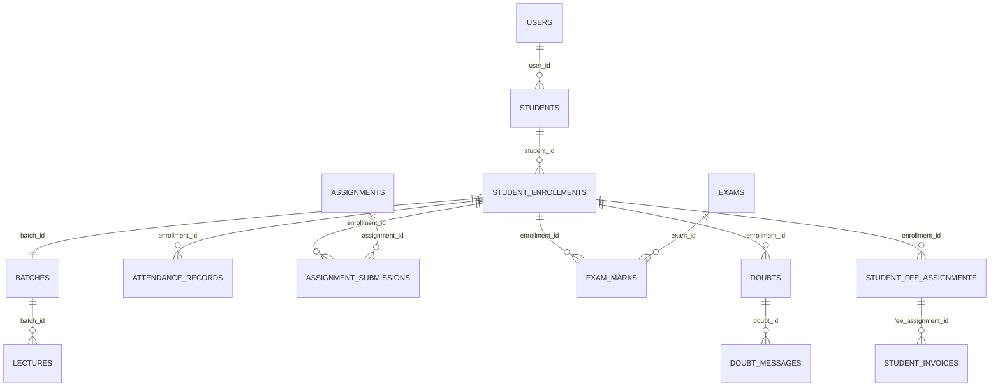

# Student Application & Mobile Portal API Specification

This document details the database schema analysis, entity mappings, and complete API specifications for the Student Application (Mobile App and Student Web Portal) in Vidyasetu.

---

## 1. Database Entity & Schema Mapping

The Student Application leverages the existing relational schema without requiring redundant tables. All queries enforce multi-tenancy (`tenant_id`) and student scoping via `student_enrollments`.



### Table & Column Details

| Table | Key Columns | Purpose |
| :--- | :--- | :--- |
| **`users`** | `id`, `tenant_id`, `name`, `email`, `mobile`, `password_hash`, `user_type`, `status`, `must_change_password` | Student authentication, credential validation, JWT claims |
| **`students`** | `id`, `tenant_id`, `user_id`, `primary_branch_id`, `student_code`, `first_name`, `last_name`, `dob`, `gender`, `mobile`, `email`, `city`, `state`, `category`, `school_name`, `current_class`, `board_id`, `target_exam`, `blood_group`, `profile_photo_url`, `status` | Student core profile and personal demographics |
| **`guardians` / `student_guardians`** | `id`, `full_name`, `relation_type`, `mobile`, `email`, `occupation` | Guardian / Parent details & emergency contacts |
| **`student_enrollments`** | `id`, `tenant_id`, `branch_id`, `student_id`, `batch_id`, `academic_year_id`, `enrolled_date`, `status`, `app_access_enabled` | Batch assignment, academic year, and app authorization |
| **`batches` / `programs` / `subjects`** | `id`, `name`, `code`, `course_id`, `level_id`, `start_date`, `end_date` | Academic structure, curriculum, and course info |
| **`lectures`** | `id`, `tenant_id`, `branch_id`, `batch_id`, `day_of_week`, `lecture_date`, `start_time`, `end_time`, `subject_id`, `teacher_user_id`, `classroom_id`, `lecture_type`, `topic`, `status` | Daily & weekly schedule / timetable |
| **`attendance_records` / `attendance_sessions`** | `session_id`, `enrollment_id`, `status` (*present/absent/late*), `remarks`, `date` | Student daily & subject-wise attendance tracking |
| **`assignments` / `assignment_files`** | `id`, `batch_id`, `subject_id`, `title`, `description`, `due_date`, `max_marks`, `is_submission_allowed` | Homework and assessment tasks published by teachers |
| **`assignment_submissions` / `assignment_submission_files`** | `id`, `assignment_id`, `enrollment_id`, `submitted_at`, `status`, `marks_obtained`, `teacher_feedback`, `graded_at` | Student's submitted work, attachments, marks & teacher feedback |
| **`exams` / `exam_marks`** | `id`, `name`, `exam_type`, `exam_date`, `max_marks`, `passing_marks`, `marks_obtained`, `is_absent`, `grade`, `remarks`, `is_result_visible` | Exam schedules, scorecards, and term-end report cards |
| **`doubts` / `doubt_messages` / `doubt_attachments`** | `id`, `enrollment_id`, `subject_id`, `assigned_teacher_id`, `topic`, `status`, `sender_id`, `message`, `attachment_url` | 2-way doubt resolution with teachers |
| **`student_fee_assignments`** | `id`, `gross_amount`, `total_concession`, `net_amount`, `paid_amount`, `balance_amount`, `installment_count`, `status` | Fee structure, concessions, and overall fee balance |
| **`student_invoices`** | `id`, `invoice_number`, `installment_number`, `issue_date`, `due_date`, `amount`, `paid_amount`, `balance_due`, `payment_date`, `payment_mode`, `status` | Installment breakdown, due dates, receipts, payment history |
| **`student_documents`** | `id`, `document_type`, `file_name`, `file_path`, `verified_status` | Certificates, marksheets, ID proof uploads |
| **`notifications` / `announcements`** | `id`, `title`, `message`, `type`, `target_audience`, `created_at`, `is_read` | Institute circulars, batch alerts, push notifications |
| **`app_devices` / `push_tokens`** | `user_id`, `device_id`, `fcm_token`, `platform`, `is_active` | Mobile app push notification registration |

---

## 2. Complete Student Application API Inventory

### Module 1: Authentication & Device Management
| Method | Endpoint | Description | Auth Required |
| :--- | :--- | :--- | :--- |
| `POST` | `/api/app/auth/login` | Student login with student code/email and password | No |
| `POST` | `/api/app/auth/refresh-token` | Refresh expired JWT access token | No |
| `POST` | `/api/app/auth/forgot-password` | Send OTP / reset link for password recovery | No |
| `POST` | `/api/app/auth/reset-password` | Set new password using verified OTP/token | No |
| `POST` | `/api/app/auth/change-password` | Change password (required if `must_change_password = 1`) | Yes |
| `POST` | `/api/app/auth/register-device` | Register FCM push notification token & device metadata | Yes |
| `POST` | `/api/app/auth/logout` | Invalidate active session and deregister device token | Yes |

---

### Module 2: Profile & Demographics
| Method | Endpoint | Description | Auth Required |
| :--- | :--- | :--- | :--- |
| `GET` | `/api/app/profile` | Get full student details (personal info, branch, enrollment, photo) | Yes |
| `PUT` | `/api/app/profile` | Update contact information (mobile, email, address) | Yes |
| `POST` | `/api/app/profile/photo` | Upload / update profile avatar | Yes |
| `GET` | `/api/app/profile/guardians` | Get parent/guardian details and emergency contact | Yes |
| `GET` | `/api/app/profile/documents` | List uploaded student documents & verification status | Yes |

---

### Module 3: Academic Enrollment & Faculty
| Method | Endpoint | Description | Auth Required |
| :--- | :--- | :--- | :--- |
| `GET` | `/api/app/academic/enrollment` | Get current active enrollment (Batch, Course, Academic Year) | Yes |
| `GET` | `/api/app/academic/subjects` | List of enrolled subjects and curriculum modules | Yes |
| `GET` | `/api/app/academic/faculty` | List of assigned teachers/professors for the student's batch | Yes |

---

### Module 4: Timetable & Schedule
| Method | Endpoint | Description | Auth Required |
| :--- | :--- | :--- | :--- |
| `GET` | `/api/app/schedule/today` | Get today's lecture schedule (timings, subject, teacher, classroom) | Yes |
| `GET` | `/api/app/schedule/calendar` | Get monthly/weekly schedule with date range (`?from=...&to=...`) | Yes |
| `GET` | `/api/app/schedule/lectures/:id` | Get details of a specific lecture session (topic covered/notes) | Yes |

---

### Module 5: Attendance Tracker
| Method | Endpoint | Description | Auth Required |
| :--- | :--- | :--- | :--- |
| `GET` | `/api/app/attendance/summary` | Overall attendance stats (Total classes, Present, Absent, Attendance %) | Yes |
| `GET` | `/api/app/attendance/history` | Date-wise attendance calendar log (filter by `?date=...`, `?from=...&to=...`, `?month=...&year=...`, `?subjectId=...`) | Yes |
| `GET` | `/api/app/attendance/subject-wise` | Subject-wise attendance breakdown | Yes |

---

### Module 6: Homework & Assignments
| Method | Endpoint | Description | Auth Required |
| :--- | :--- | :--- | :--- |
| `GET` | `/api/app/homeworks` | List homeworks with status filter (`?status=pending\|submitted\|graded\|overdue`) `[Paginated]` | Yes |
| `GET` | `/api/app/homeworks/:id` | Get homework details, instructions, teacher attachments, and due date | Yes |
| `POST` | `/api/app/homeworks/:id/submit` | Submit homework solution (text remarks + file attachments) | Yes |
| `GET` | `/api/app/homeworks/:id/my-submission` | View submitted work, evaluation status, marks obtained, and teacher remarks | Yes |

---

### Module 7: Exams & Assessments
| Method | Endpoint | Description | Auth Required |
| :--- | :--- | :--- | :--- |
| `GET` | `/api/app/exams/upcoming` | List upcoming scheduled exams with dates, timings, and syllabus topics | Yes |
| `GET` | `/api/app/exams/completed` *(or `/results`)* | List completed exam results (marks obtained, max marks, percentage, grade, pass/fail) `[Paginated]` | Yes |
| `GET` | `/api/app/exams/results/:examId` | Detailed exam score breakdown with teacher remarks & rubric | Yes |

---

### Module 8: Doubts & Query Resolution
| Method | Endpoint | Description | Auth Required |
| :--- | :--- | :--- | :--- |
| `GET` | `/api/app/doubts` | List student doubts with status filter (`?status=open\|in_progress\|resolved\|reopened`) `[Paginated]` | Yes |
| `POST` | `/api/app/doubts` | Create a new doubt (select subject, topic, message, attachments) | Yes |
| `GET` | `/api/app/doubts/:id` | Get doubt thread with all back-and-forth messages and attachments | Yes |
| `POST` | `/api/app/doubts/:id/messages` | Reply in a doubt thread | Yes |

---

### Module 9: Fees, Invoices & Payment History
| Method | Endpoint | Description | Auth Required |
| :--- | :--- | :--- | :--- |
| `GET` | `/api/app/fees/summary` | Overall fee status (Total Fee, Total Paid, Balance Due, Next Due Date) | Yes |
| `GET` | `/api/app/fees/invoices` | List of installment invoices (paid & pending) `[Paginated]` | Yes |
| `GET` | `/api/app/fees/invoices/:id/receipt` | Get/Download receipt PDF details for a paid invoice | Yes |

---

### Module 10: Announcements & Notifications
| Method | Endpoint | Description | Auth Required |
| :--- | :--- | :--- | :--- |
| `GET` | `/api/app/announcements` | List institute & branch circulars / notice board `[Paginated]` | Yes |
| `GET` | `/api/app/notifications` | List student notifications (homework alerts, exam dates, fee reminders) `[Paginated]` | Yes |
| `PUT` | `/api/app/notifications/:id/read` | Mark a notification as read | Yes |
| `GET` | `/api/app/notifications/unread-count` | Badge count of unread notifications | Yes |

---

## 3. Architecture & Security Standards

1. **Multi-Tenant Scoping:** All student queries automatically filter by `tenant_id` and the student's active `enrollment_id` derived securely from the verified JWT `userId`.
2. **Standard API Response Format:**
   ```json
   {
     "success": true,
     "data": { ... },
     "message": "Optional human-readable message"
   }
   ```
3. **Standard Error Response Format:**
   ```json
   {
     "success": false,
     "message": "Error description string"
   }
   ```
4. **Standard Server-Side Pagination Schema:**
   All listing endpoints marked with `[Paginated]` accept `?page=1&limit=20` (defaults: `page=1`, `limit=20`, max `limit=100`) and return a standardized `pagination` object:
   ```json
   {
     "success": true,
     "data": {
       "pagination": {
         "page": 1,
         "limit": 20,
         "total": 45,
         "totalPages": 3,
         "hasNext": true,
         "hasPrev": false
       },
       "items": [ ... ]
     }
   }
   ```
5. **File Storage:** Solution uploads and doubt attachments utilize the existing `appUploadMiddleware.js` standard with stored paths under `/uploads/homework-submissions/` and `/uploads/doubts/`.
